# Meta Levels

Computed live from the report (`meta_levels_from_report()` → `meta_levels_build()`). Surfaces: web view `heroes/meta_levels`, WebAPI `mod=heroes-meta_levels`. Hero tier lists reuse the same result as a rank boost.

## The model

A metagame develops in layers:

- **Meta-0** forms when something resets the game: a patch lands, a tournament starts. It's the heroes that are simply, objectively strong or pupular: omnipresent, contested in almost every draft.
- **Meta-1** emerges as the answer to Meta-0.
- **Meta-2** answers Meta-1, and so on.

Notes:
- Earlier layers don't disappear when the next arrives; they lose a little popularity and winrate. Weaker players stay on the earlier layers, stronger players move to the next.
- Eventually layers **loop**, because the answers to certain heroes repeat.

Each layer has a **core** (the heroes that define it) and **complimentary** heroes (that pair with the core well). Past the last observed layer, a few **projections**
extrapolate what comes next.

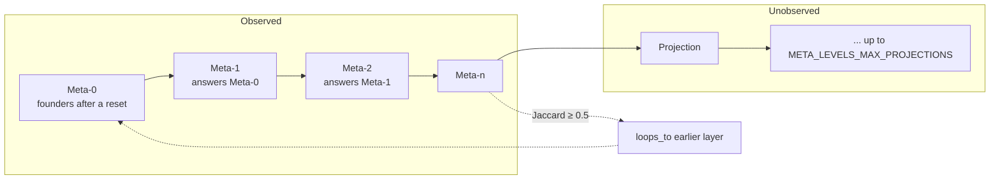

A layer is not a replacement of the previous one. The earlier core stays in the pool; the next window is scored as *who answers it*.

## Inputs

All four must be present or the feature renders nothing (`meta_levels_from_report()`):

| Section | Used for |
|---|---|
| `hero_daily_wr` | per-day pick/ban/winrate — the timeline |
| `pickban` | overall picks, bans, winrate |
| `hvh` | hero-vs-hero winrates — "counters" |
| `hph` | hero+hero synergy — "combos" |

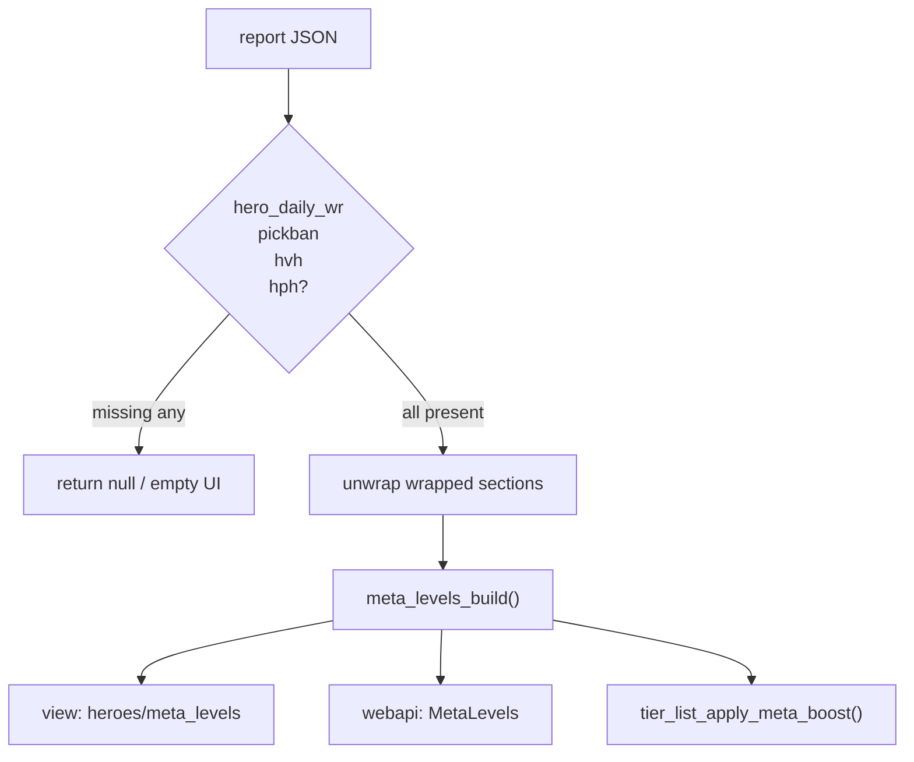

## Pipeline

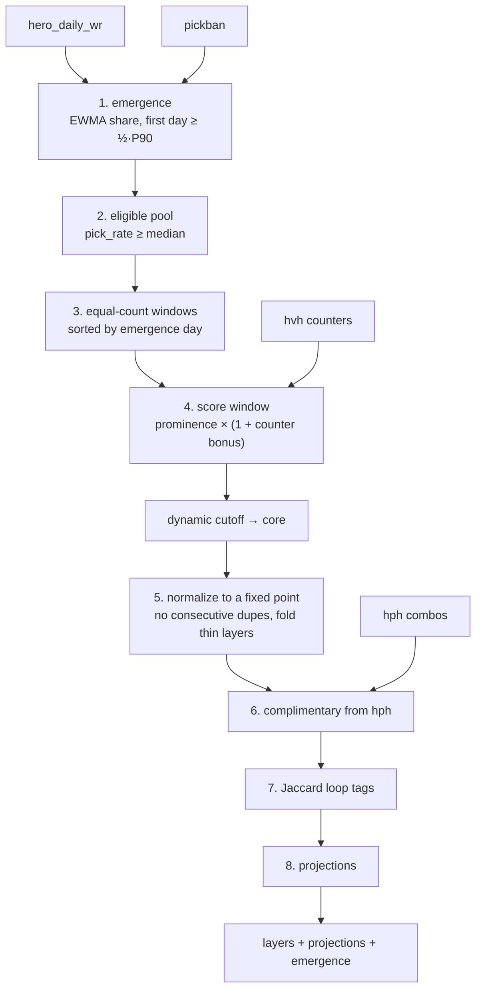

## Step 1: when did each hero emerge?

For hero *h* on day *t*, its share of that day's **contest** (picks plus bans) is

```
share_h(t) = (picks_h(t) + bans_h(t)) / Σ_i (picks_i(t) + bans_i(t))
```

smoothed with an EWMA (α = `META_LEVELS_EWMA_ALPHA` = 0.3):

```
E_h(t) = (1-α)·E_h(t-1) + α·share_h(t)
```

The **emergence day** is the first *t* where `E_h(t) ≥ ½ · P90(E_h)` -- classic time-to-half-max, with the 90th percentile standing in for the peak.

Notes:
- **Not** "first day the hero was picked at all". In a long report nearly every hero has a stray early pick, which makes that measure pure noise.
- **P90, not the maximum.** One freak day on a low-volume date would otherwise set the scale.
- **Not the hero's own long-run average** either. A hero that is omnipresent from day one has an average nearly equal to its steady level, so it only clears its own average after the EWMA has fully ramped, pushing them out of Meta-0.

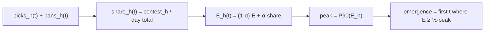

## Step 2: who is eligible

**Prominence** is contest-first, with winrate as a multiplier. A hero constantly removed from the pool defines the meta as much as one constantly picked, so picks and bans count the same (`contest_rate = pick_rate + ban_rate`):

```
prominence_h = contest_rate_h · (1 + 4·max(0, winrate_h − 0.5))
```

The **eligible pool** is heroes at or above the median contest rate (`META_LEVELS_ELIGIBILITY_MULT` = 1.0). This is what keeps a hero with a great winrate over a handful of games out of the layers entirely. A hero needs `META_LEVELS_MIN_PICKS_FLOOR` = 3 picks *plus bans* to be considered at all.

## Step 3: emergence windows

Heroes are sorted by emergence day and cut into **equal-count windows**; window *w* is layer *w*'s pool of new arrivals. The layer count is

```
k = clamp( min( ⌈days / 3⌉, ⌊|pool| / 8⌋ ), 1, 12 )
```

bounded by both how long the timeline is and how many heroes there are to go round

Hero turnover isn't uniform over a season, and equal-duration windows leave some layers with nothing to draw a core from.

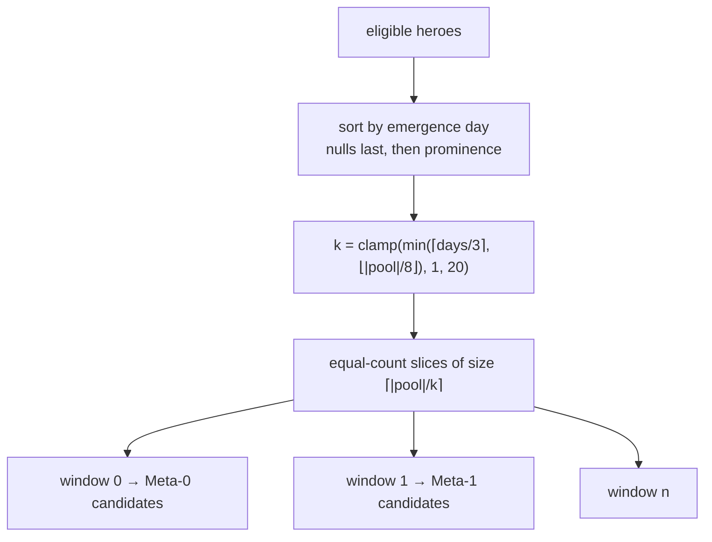

## Step 4: the core of each layer

Candidates are that window's **new arrivals**. They qualify on prominence alone:

```
score_h = prominence_h · (1 + counter_bonus(h, core_{w-1}))
```

Scoring the whole pool instead looks reasonable and is badly wrong: prominence barely changes between windows, so the same few most-picked heroes win every window they aren't explicitly blocked from, producing an A/B/A/B ping-pong and crowding genuine late emergers out of the final
layers.

A former core hero **may return**, but it's an exception with a price of admission: it must have sat out `META_LEVELS_RETURN_COOLDOWN` = 3 layers, be measurably more picked during this window than across the report as a whole (`META_LEVELS_RETURN_RESURGENCE` = 1.15 -- a real resurgence, not just a big name), and beat the previous core. At most 2 per layer, discounted x0.9 so a layer stays mostly its own era.

### The counter bonus

Given hero *h* and a core *C*, over pairings with at least `META_LEVELS_MIN_PAIR_MATCHES` = 5
games:

```
beat_share = |{c ∈ C : winrate(h,c) > 0.5}| / |C_trusted|
edge       = mean(winrate(h,c) − 0.5)
bonus      = max(0, 2·(beat_share − ½)) · (1 + 4·max(0, edge))
```

**`beat_share`, not the aggregate winrate.** Counter relationships in Dota are cyclic: a genuine
answer beats *part* of a core decisively while losing mildly to the rest. Averaged across six
heroes that nets out near even and the hero looks like nothing — in testing, all 46 candidates
had head-to-head data and *zero* cleared an aggregate-winrate bar.

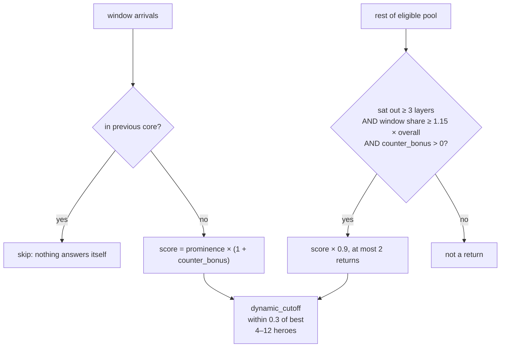

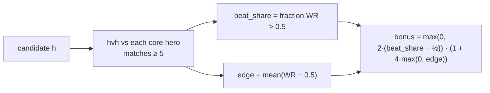

## Step 5: complimentary heroes

Computed **after every core is final**, for a pair (core hero *a*, candidate *o*) from `hph`:

```
requires: matches(a,o) ≥ 5,  matches > expected,  wr_diff > 0
score_o = max over a of  (matches − expected) · (1 + 5·wr_diff)
```

## Step 6: layer sizing, loops, normalisation

Layers aren't a fixed size. `meta_levels_dynamic_cutoff()` takes everyone within `META_LEVELS_CORE_RATIO` = 0.3 of the window's best score, bounded by `META_LEVELS_MIN_CORE` = 4 and `META_LEVELS_MAX_CORE` = 8, topping up from the next-best candidates rather than emitting a thin layer.

`meta_levels_normalize()` then enforces, **to a fixed point** (the two rules re-trigger each other):

1. no hero is core in two consecutive layers: layer N+1 answers layer N, and nothing answers itself;
1. layers under the minimum are folded into the previous one.

A **loop** is annotated when Jaccard similarity between two layers' cores reaches `META_LEVELS_LOOP_SIMILARITY` = 0.5, provided both have ≥ 3 heroes (below that, similarity is
coincidence).

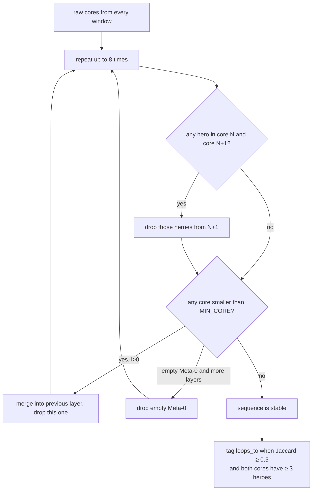

## Step 7: projections

Up to `META_LEVELS_MAX_PROJECTIONS` = 3 layers past the last real one, each chained off the previous projection.

Projections draw from a **wider, less-picked band** (≥ 0.5× median contest rate): the layers consume nearly all the prominent heroes.

The evidence bar **loosens with each step** (`min_pairs = max(1, 3 − step)`), because each step's reference core is itself speculative and its samples are thin. Holding every step to the first step's bar is what made the chain stop after one projection on long reports.

If the trend path still can't fill a layer, it falls back to a **loop**: the earlier layer whose core best beats the current reference, flagged `method: 'loop'` with `loops_to`.

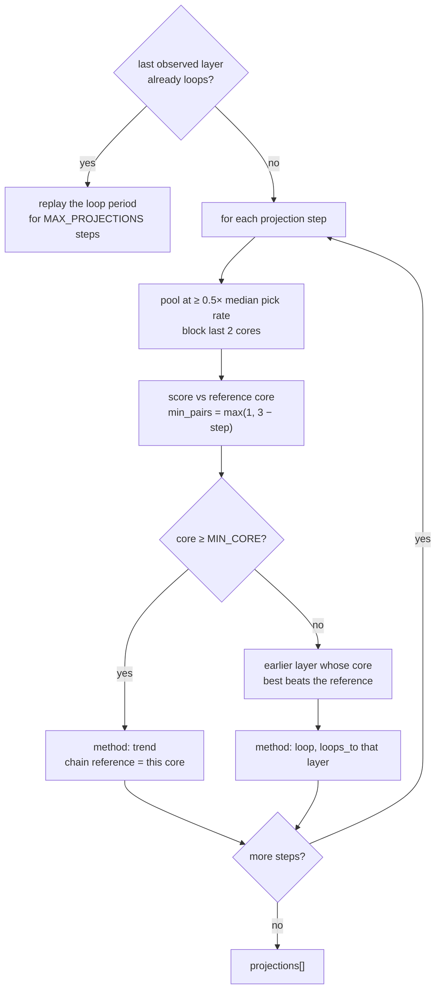

## Heroes of a player or a team

Same Wilson score per hero, `confidence = 1 − matches/games` (games = how many matches the player or team played), blended with contest the way the heroes list is. For a player, contest is the number of games on the hero; for a team it's the team's picks plus the bans opponents spent on that hero against the team (`pickban_vs`).

The "too few games" bar adapts to the sample: `max(1, min(3, ⌊games/5⌋))`, so a short roster history doesn't push everything into **Unplaced**.

## Output model

API omits `emergence`; the view uses cores/combos only. `reasoning` tags heroes as `meta0_founder`, `counters_*`, `carried_over`, or `combo_piece`.

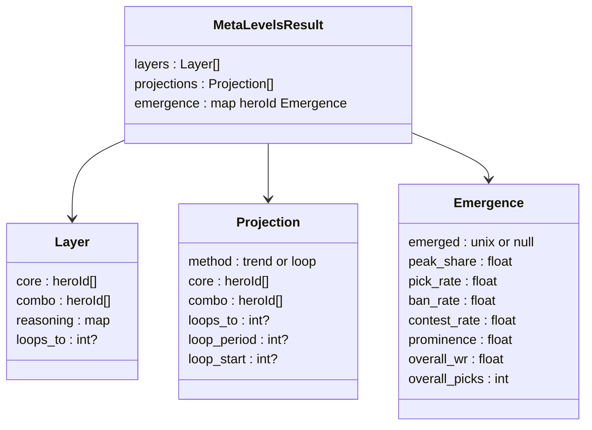

---

# Tier Lists

Structured as `Heroes → [Meta, Players, Teams]`, `Players → Heroes`, `Teams → Heroes`; all soft-gen:

- **Heroes → Meta** -- overall, one list per role, and all roles side by side (one column per role).
- **Heroes → Players** -- pick a hero, see who performs best on it.
- **Heroes → Teams** -- the same by team.
- **Players → Heroes** -- pick a player, see tiers of the heroes they play. Linked from the player profile, after the heroes table.
- **Teams → Heroes** -- the same for a team; it is the very list shown in the team profile (`heroes → tierlist`).

Surfaces: web view `tierlists-heroes-{meta,players,teams}`, `tierlists-players-heroes-playerid<id>`, `tierlists-teams-heroes-team<id>` (the old `tierlists-heroes-total`, `tierlists-players-heroid<id>` etc. are redirected).
WebAPI `mod=tierlists-heroes-meta[-position_1.1]`, `tierlists-heroes-players-heroid<id>`, `tierlists-heroes-teams-heroid<id>`, `tierlists-players-heroes-playerid<id>`, `tierlists-teams-heroes-team<id>`; the legacy `tierlists-players` / `tierlists-teams` with `hero=` still mean players/teams on a hero.

All cards in these lists can be collapsed with the **Simple view** toggle (next to the explainer; also on meta levels and builds): labels disappear and unravel on hover, the state lives in `localStorage`.

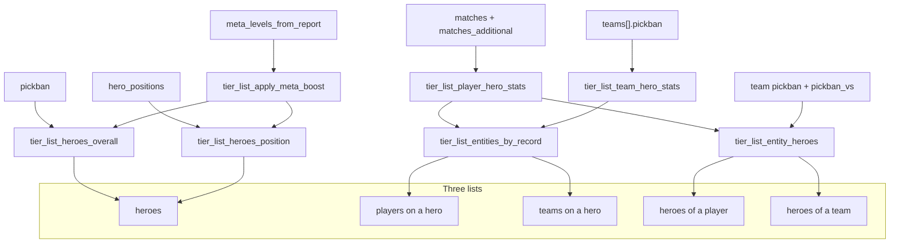

## Heroes: the score

The base is the same **rank** the pick/ban and positions tables show: a Wilson score folding popularity and winrate together, normalised to 0..100 across the field. Then two corrections are applied.

**Contest.** A hero can rank well off a small favourable sample, and a hero nobody dares to leave in the pool can win few games when it does get picked. So the score blends the rank with how contested the hero was, picks **plus bans**, relative to the most contested hero:

```
score = 100 · (rank/100)^0.75 · (contest / max contest)^0.25
```

(`TIER_LIST_SKILL_WEIGHT` / `TIER_LIST_CONTEST_WEIGHT`.) A hero picked 8 times and banned 139 of 147 matches with 87.5 % winrate sits in S; a hero with a perfect rank off three games doesn't. For a role list, bans aren't tracked per role, so a hero's bans are split between its roles by the share of its picks.

**Meta levels**, when available. Being part of a formed meta is evidence the raw rank of a niche-but-effective hero doesn't capture. For a hero in layer *i* of *n* (projections counted as the last layers):

```
boost = (3 + 5 · i/(n−1)) × (1 for core, 0.5 for complimentary)
```

Later layers get more -- they're the more current answers. The final ordering score is `score + boost`, clamped to 100.

**Not meta** is no longer a score cutoff. A hero goes there when both of these hold: picks below `TIER_LIST_PICKS_FLOOR` = 0.9× the median number of picks, and contest rate below `TIER_LIST_CONTEST_RATE_FLOOR` = 5 % (picks plus bans, over the matches in the list). Either one on its own keeps the hero tiered, so a rarely picked hero that is heavily banned stays in, and a modestly picked hero stays in whatever its contest rate.

Contest still moves a hero up or down inside the tiers, and that can park a badly performing hero next to much stronger ranks. There is no fixed rank floor for that. After the presence check, the bottom of the plain-rank list is split off into **Not meta** only when the step up to the next hero is more than `TIER_LIST_RANK_GAP` = 4 times the typical step. A rank of 11 falling away from a cluster at 30+ goes; a smooth run of close ranks stays.

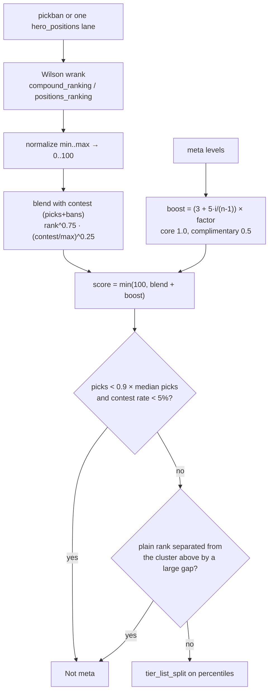

Displayed rank in the UI is still the **plain** 0..100 Wilson rank (`base`). Contest and meta boost only decide which letter the hero sits in.

## Cutting into tiers

Tiers are cut on **percentile**, not on the raw rank value.

The cut points are **not** six equal slices either. `TIER_LIST_SHARES` gives each tier a share of the field, best first:

| S | A | B | C | D | E |
|---|---|---|---|---|---|
| 7.5 % | 14 % | 20.5 % | 23.5 % | 20.5 % | 14 % |

Roughly a normal distribution centred on **C**, so the bulk of the roster sits mid-table and S is a genuine outlier rather than a flat sixth of everything.

It's really a bell over *seven* tiers — S A B C D E **F**, with C dead centre, but F is never rendered.

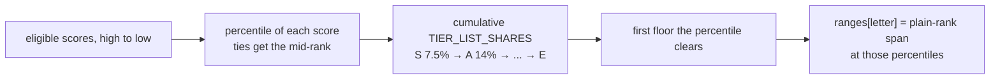

## Players and teams on a hero

No contest or meta correction, just performance on the selected hero, by Wilson score so a short strong run doesn't outrank a long record on noise:

```
wilson(wins, matches, confidence = 1 − matches/total)
```

Player + hero records are walked out of the baked `matches` list; team + hero records come straight off each team's `pickban` block.

Entities under `TIER_LIST_MIN_MATCHES` = 3 games on the hero go to an **Unplaced** bucket.

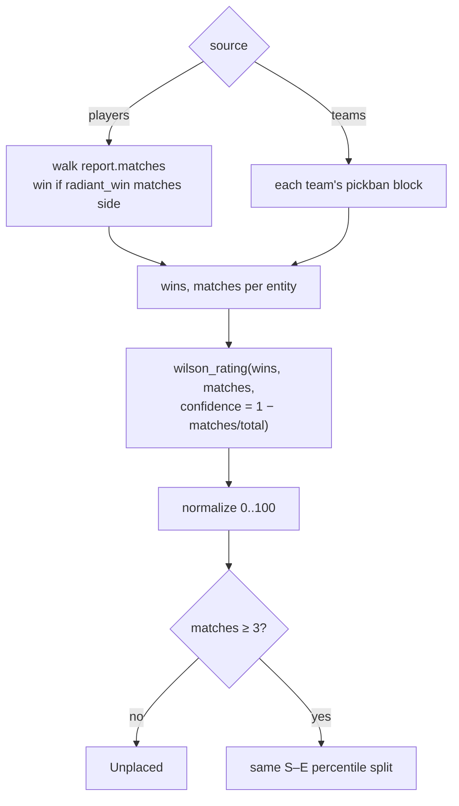

## Output model

`not_meta` (heroes) / unplaced ids (players, teams) live on the same `tiers` map. `ranges` is the displayed Wilson-rank span, not the boosted ordering score.

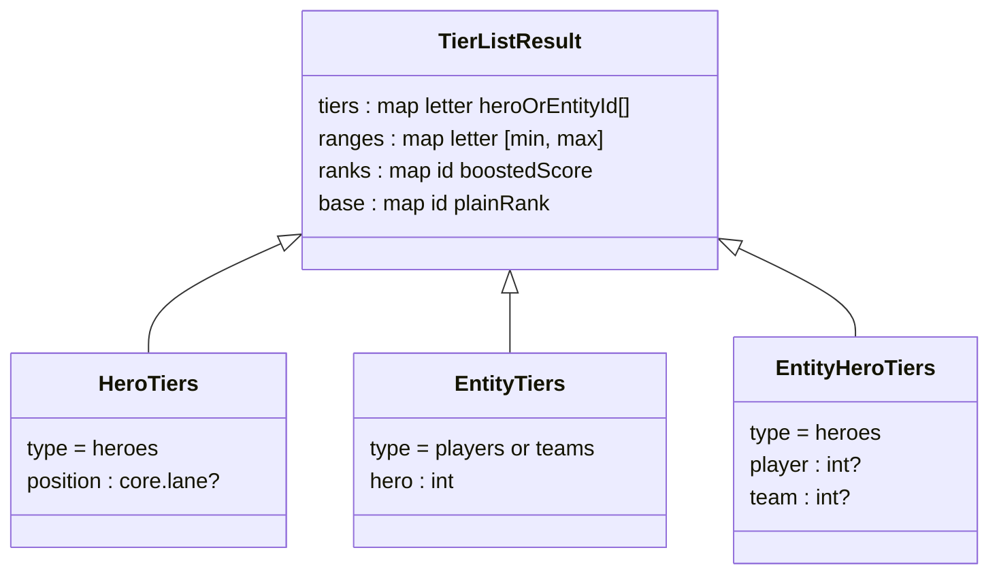

---

## Tuning

Every constant is at the top of its functions file, and each is a named `const` with a comment.
The ones most likely to want adjusting:

| Constant | Effect |
|---|---|
| `META_LEVELS_TARGET_WINDOW` | heroes per window → how loaded layers are, and how many there are |
| `META_LEVELS_BUCKETS_PER_LAYER` | how quickly timeline length turns into more layers |
| `META_LEVELS_MIN_PAIR_MATCHES` | evidence required before a matchup counts |
| `META_LEVELS_RETURN_COOLDOWN` / `_RESURGENCE` | how readily heroes come back |
| `TIER_LIST_PICKS_FLOOR` / `TIER_LIST_CONTEST_RATE_FLOOR` | both required for "Not meta": low picks and a low contest rate |
| `TIER_LIST_RANK_GAP` | how wide a plain-rank gap at the bottom has to be before that tail is "Not meta" |
| `TIER_LIST_SKILL_WEIGHT` / `TIER_LIST_CONTEST_WEIGHT` | how much winrate vs. contest decides the tier |
| `TIER_LIST_META_BOOST_BASE` / `_STEP` | how much meta-level membership is worth |
| `TIER_LIST_TIERS` | the tier letters themselves — the split adapts to however many there are |
